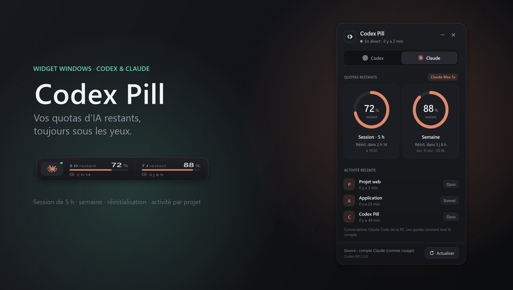
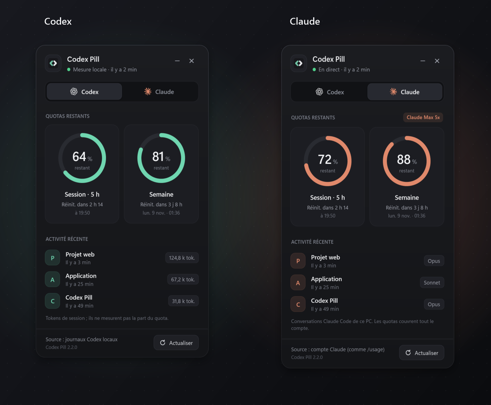
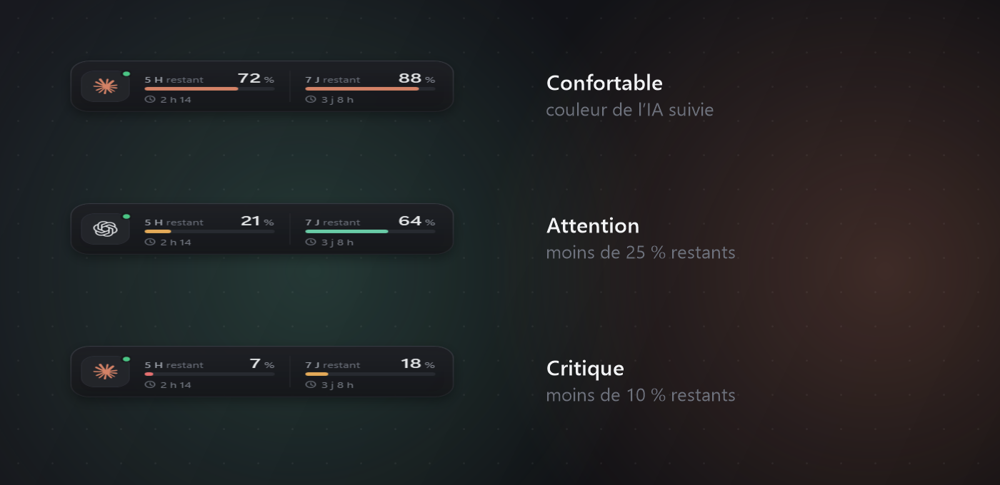

<div align="center">

# Codex Pill

**Vos quotas Codex et Claude restants, toujours sous les yeux.**

Un widget de bureau discret pour Windows qui affiche en permanence ce qu'il vous reste
sur la session de 5 heures et sur la semaine, sans ouvrir aucune application.

[](https://github.com/Vert-Jade/Codex-Pill/releases/latest)
&nbsp;

&nbsp;


<br>



</div>

---

## Pourquoi Codex Pill ?

Les abonnements Codex et Claude limitent l'usage par fenêtres glissantes : une **session
de 5 heures** et une **limite hebdomadaire**. Savoir où vous en êtes oblige d'ouvrir une
page, de taper `/usage` ou d'attendre le message « limite atteinte » au pire moment.

Codex Pill place une petite pastille dans un coin de l'écran. Un coup d'œil suffit pour
savoir ce qu'il vous reste et quand le compteur repart à zéro.

## Fonctionnalités

- **La part restante, pas la part consommée** : les jauges se vident à mesure que vous
  utilisez l'IA, comme une batterie.
- **Codex et Claude** : passez de l'un à l'autre d'un clic. Les mesures ne sont jamais
  mélangées.
- **Claude en direct** : les quotas viennent du compte lui-même, comme `/usage`. Ils
  couvrent l'extension VS Code, le terminal, le site et le mobile.
- **Réinitialisation lisible** : compte à rebours et heure exacte (« dans 2 h 14 ·
  à 19:50 »).
- **Alertes visuelles** : la couleur de l'IA suivie en temps normal, orange sous 25 %,
  rouge sous 10 %.
- **Activité récente** : les derniers projets utilisés, avec leur modèle ou leurs tokens.
  L'icône de l'application s'affiche quand le projet en possède une.
- **Discret** : déplaçable, toujours au premier plan si vous le souhaitez, réductible
  dans la zone de notification, et lancement possible avec Windows.
- **Léger et autonome** : Windows PowerShell et WPF intégrés à Windows. Rien à
  installer, aucun droit administrateur.

## Aperçu

<div align="center">



*Chaque IA garde son identité : jade pour Codex, terracotta pour Claude.*

<br>



*La pastille change de couleur quand un quota devient bas.*

</div>

## Installation

1. Téléchargez **`Codex-Pill-x.y.z.zip`** depuis la
   [dernière version](https://github.com/Vert-Jade/Codex-Pill/releases/latest).
2. Extrayez **tout** le ZIP dans un dossier que vous conserverez, par exemple
   `Documents\Codex Pill`. Ne lancez pas les fichiers depuis l'intérieur du ZIP.
3. Double-cliquez sur **`Creer raccourci bureau.cmd`** : un raccourci « Codex Pill » avec
   son logo apparaît sur le Bureau, OneDrive compris.
4. Lancez le raccourci.

> Pour mettre à jour, quittez l'ancienne version (clic droit › Quitter Codex Pill), puis
> remplacez les fichiers du dossier. Vos préférences sont conservées.

**Configuration requise** : Windows 10 ou 11, avec Codex et/ou Claude Code utilisés sur ce PC.

## Utilisation

| Geste | Effet |
| --- | --- |
| **Clic** sur la pastille | Ouvre le panneau de détails |
| **Glisser** | Déplace la pastille (position mémorisée) |
| **Clic droit** | Menu : premier plan, démarrage avec Windows, dossier des données… |
| **Bouton –** du panneau | Réduit dans la zone de notification ; le suivi continue |
| **Double-clic** sur l'icône de notification | Réaffiche la pastille |
| **Échap** | Ferme le panneau |

Choisissez l'IA à suivre en haut du panneau. Ce choix est mémorisé.

## D'où viennent les chiffres ?

### Codex

Codex Pill lit les journaux de session que Codex écrit sur votre PC
(`%USERPROFILE%\.codex\sessions`, ou `CODEX_HOME` s'il est défini), **en lecture seule et
sans réseau**. Les valeurs sont les dernières mesures de quota présentes dans ces
journaux. Une mesure ancienne est signalée comme telle.

### Claude

Il n'y a rien à configurer. Codex Pill interroge toutes les 60 secondes le service d'usage
de votre compte Claude, celui qu'utilise la commande `/usage` de Claude Code. Il réutilise
pour cela la connexion déjà enregistrée par Claude Code sur ce PC
(`%USERPROFILE%\.claude\.credentials.json`) :

- le jeton est relu à chaque fois et n'est **jamais copié, journalisé ni affiché** ;
- il n'est envoyé **qu'à `api.anthropic.com`**, en HTTPS ;
- le widget **ne renouvelle jamais** la connexion. Si elle expire, il suffit d'ouvrir
  Claude Code.

L'activité récente est tirée des conversations Claude Code locales. Seuls le dossier du
projet, l'heure et le nom du modèle sont utilisés ; le contenu des messages n'est jamais
conservé.

En option, le menu propose d'activer la **barre de statut officielle** de Claude Code en
terminal. Elle sert de seconde source, et la mesure la plus récente des deux l'emporte.
Détails : [`docs/Suivi-Claude-Code.txt`](docs/Suivi-Claude-Code.txt).

> Codex Pill ne déduit jamais un quota à partir des tokens. Une valeur inconnue s'affiche
> « — », et une échéance passée n'est jamais transformée en « 100 % disponibles ».

## Dépannage

- **Diagnostic** : lancez `Diagnostic Codex Pill.cmd`. Il vérifie les scripts, construit
  l'interface et lit les données, sans démarrer un second widget.
- **Journal** : `%APPDATA%\CodexPill\error.log` (clic droit › Ouvrir le journal des erreurs).
- **Préférences** : `%APPDATA%\CodexPill\settings.json`.
- **Arrêter** : clic droit › Quitter, ou `Arreter Codex Pill.vbs`.
- **Pastille introuvable** : clic droit sur l'icône de notification › Replacer en haut à
  droite.

## Structure du projet

```
codex-pill.ps1                Programme principal (fenêtres, lecteur en arrière-plan)
CodexPill.Ui.ps1              Interface WPF : pastille, panneau, menus
CodexPill.Core.ps1            Lecture des journaux Codex
ClaudePill.Core.ps1           Lecture du compte Claude et de l'activité locale
ClaudePill.Integration.ps1    Activation de la barre de statut Claude Code (option)
ClaudePill.StatusLine.ps1     Collecteur appelé par Claude Code (option)
CodexPill.Tray.ps1            Icône de la zone de notification
Lancer / Arreter / Diagnostic Lanceurs .vbs et .cmd
tests/                        Tests automatisés
```

## Tests

```powershell
powershell.exe -NoProfile -ExecutionPolicy Bypass -File .\tests\Test-Core.ps1
powershell.exe -NoProfile -ExecutionPolicy Bypass -File .\tests\Test-Claude.ps1
powershell.exe -NoProfile -ExecutionPolicy Bypass -File .\tests\Test-ProviderSwitch.ps1
powershell.exe -NoProfile -ExecutionPolicy Bypass -File .\tests\Test-ReaderLifecycle.ps1
```

Les tests utilisent uniquement leurs propres dossiers temporaires et n'accèdent jamais au
réseau.

## Licence

Code source sous [licence MIT](LICENSE) : libre et gratuit, y compris pour le modifier et
le redistribuer.

Codex Pill est un outil indépendant, sans lien avec OpenAI ni Anthropic. Les logos OpenAI
et Claude servent uniquement à identifier le service suivi et restent la propriété de
leurs titulaires ([sources](assets/providers/Sources.txt)).
